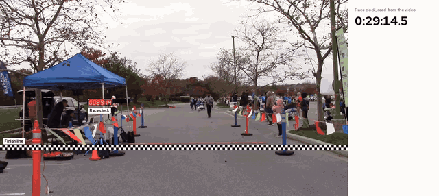

# VideoPacer, showcase

Times race runners from a finish-line video: finds the bibs, follows them, reads the numbers, gives each runner a finish time. Rust, built to run on a phone.

- 175 of 187 bibs found on 17 ground-truth videos, 171 finish times within 2 s, 8 wrong numbers.
- Core pipeline rebuilt from scratch, one reviewed idea per pull request, each with ground-truth numbers before and after.
- Full write-up: open `index.html` (or the GitHub Pages site of this repo).

The source is private for now and available on request.
